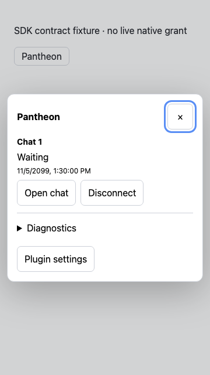
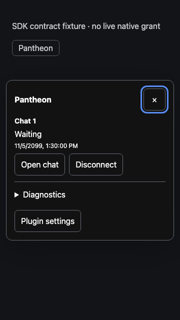

# Pantheon 1.0.14 catalogue evidence

Validated on 16 November 2026 against the exact public commit
`f637d22a618a11dccf57b3bc65b3942a604304f2`.

[Validation report](validation.json) records the stable/upstream host commits,
all 16 admission checks, file hashes, native/backend tests, original review
regressions and isolated installation/upgrade results. All three findings from
[the original review](https://github.com/NousResearch/hermes-agent/pull/152034#issuecomment-6762728234)
remain addressed. File confinement code is identical to the reviewed 1.0.6 pin.
New human-enabled incoming-reply preferences persist; older temporary grants
still restore their original setting. Neither path enables permission itself.

Screenshots below use the exact published Desktop code with an SDK adapter and
synthetic connections. They are browser layout evidence, not a live account,
Hermes Desktop acceptance or actual-agent exchange.




Reproduce from a checkout of the public commit in an isolated Hermes environment:

```sh
hermes plugins doctor /absolute/plugin --ci
hermes plugins validate /absolute/plugin --install-deps --json
python /absolute/plugin/tests/test_native.py
python /absolute/plugin/tests/dashboard_contract.py
```

For the catalogue branch, run the repository's structural check and canonical
test runner with its PM-managed test environment and toolchain on PATH:

```sh
python scripts/validate_plugin_catalog.py plugin-catalog/
python scripts/ci/catalog_test_files.py
scripts/run_tests.sh -j 2 <files printed by catalog_test_files.py>
python scripts/check --staged
```

789 catalogue tests passed. The 44 Linux-only confinement tests are skipped on
macOS and remain required in upstream CI. The whole catalogue schema passes with
warnings in unrelated existing entries; Pantheon's entry and plugin admission
have no warnings. Upstream CI, maintainer review, catalogue publication and a
catalogue-name install/update after publication remain separate gates.
